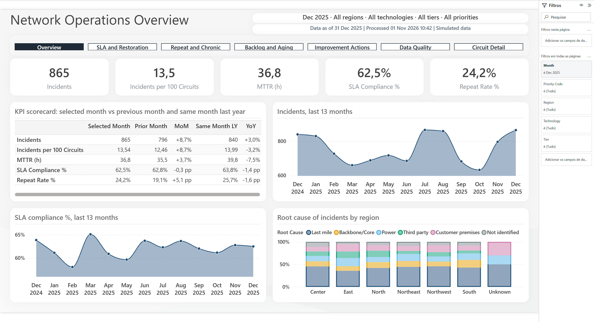
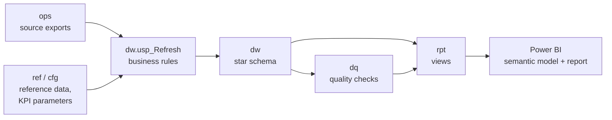
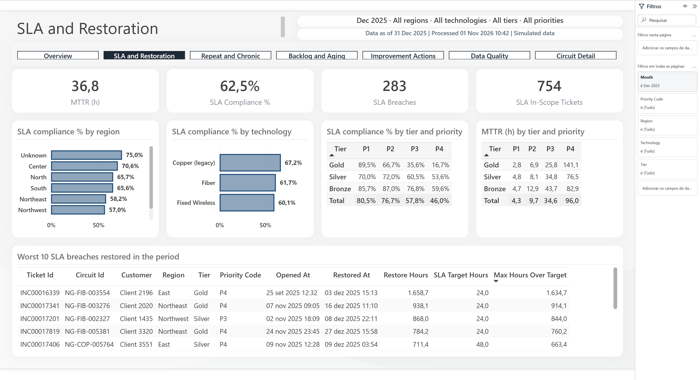
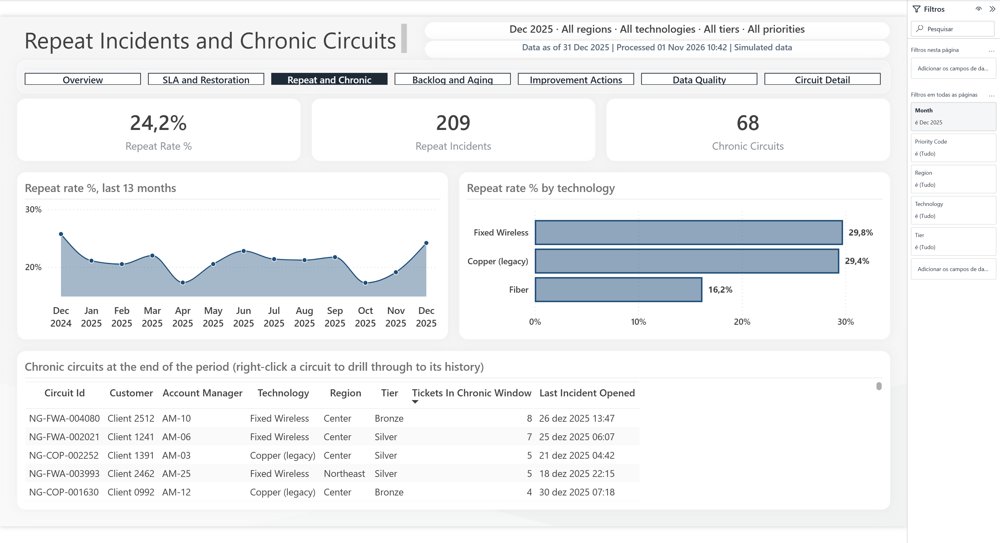
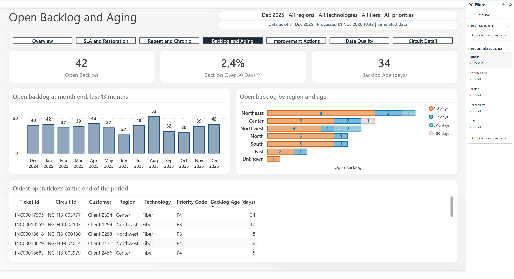
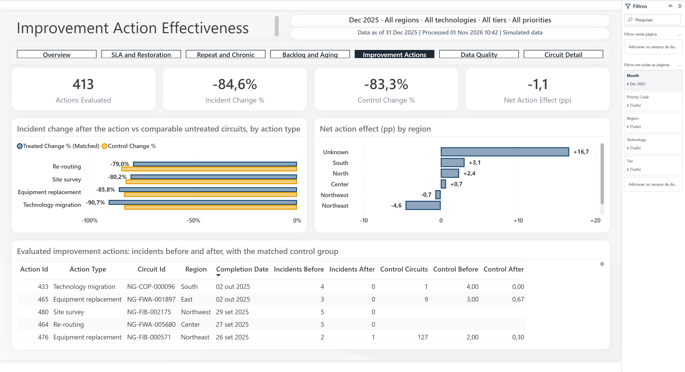
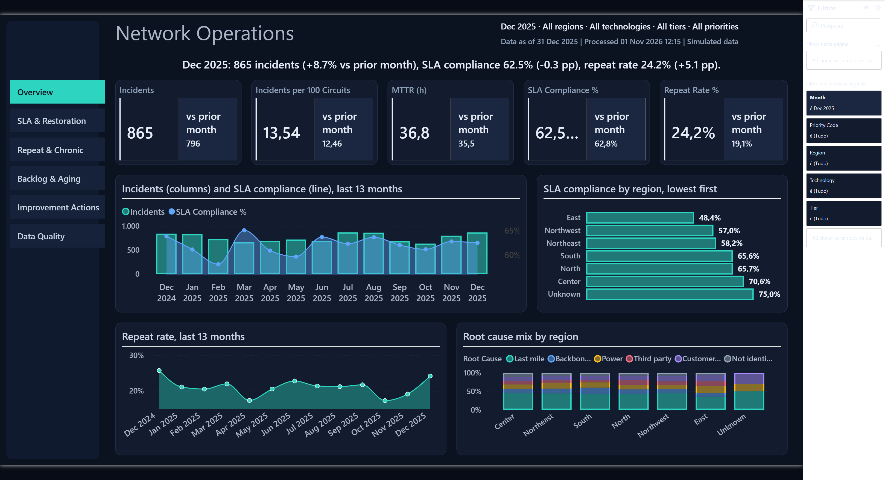
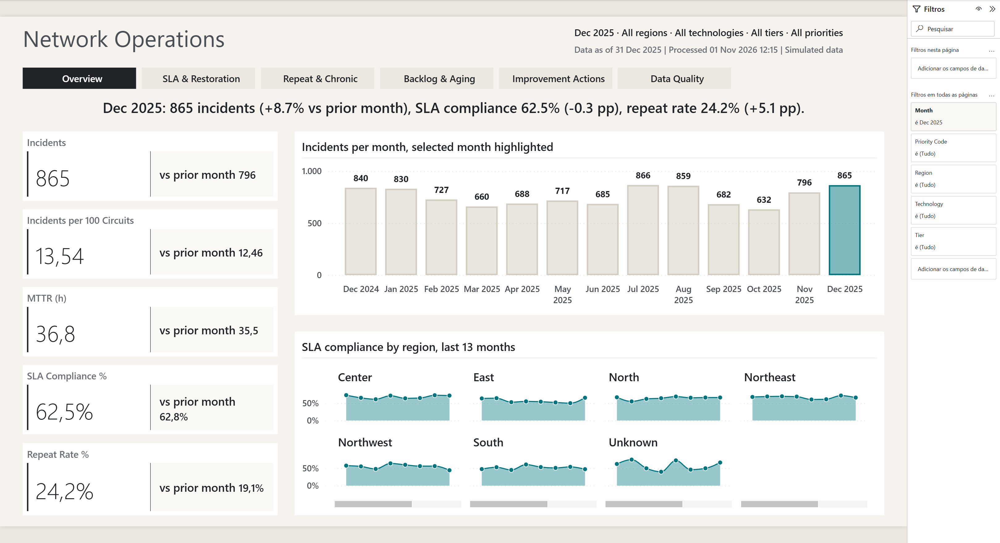

# B2B Network Operations Intelligence

> **Status: first complete version, under review.** Portfolio project by Scylla Data Lab.
> **Simulated scenario:** NorthGrid Telecom, its customers, data and every result shown are fictional.

A business intelligence solution for the B2B network operations of a (fictional) Spanish connectivity
provider: incident volume, restoration time and SLA compliance, repeat incidents and chronic circuits,
backlog aging, and whether improvement actions actually reduce failures.

Built with **SQL Server (T-SQL)**, **Power BI (PBIP: TMDL + PBIR)**, PowerShell and Python.



## The business problem

Leadership spent the first half hour of every Monday meeting arguing about whose numbers were right:
regions reported backlog with their own definitions, customers noticed repeat failures before operations
did, and nobody could say whether the money spent on improvement actions was working.
The client asked for one version of the truth, by region, technology and customer tier
(`docs/01-business-requirements.md`).

## Solution



- **SQL Server does the heavy work.** One stored procedure applies every business rule (duplicate and
  cancelled tickets, SLA scope, repeat window, daily backlog and chronic snapshots, action effectiveness) and
  stores the results as 1/0 components in a star schema. It is safe to run on a schedule: it skips unchanged
  source data, refuses concurrent runs, rebuilds in one transaction and logs every run.
- **Power BI stays light.** Import model, no calculated columns, 34 short measures that add and divide the SQL
  components, so every rate is correct under any filter. Two calculation groups handle month-over-month and
  year-over-year comparisons and 13-month trends.
- **Data quality is part of the product.** Twelve automated checks; source defects are handled by documented
  rules, and duplicate tickets are reported monthly as a service-desk process indicator.
- **Improvement actions are measured honestly.** A plain before/after comparison shows an 85% drop in incidents
  (simulated). A matched control group of untreated circuits drops almost as much: most of the "effect" is
  regression to the mean. The report shows both and the net effect.

## Report

| Page | Answers |
|---|---|
| Overview | How did the month go against the previous month and last year? |
| SLA and Restoration | Where and for which tiers and priorities do we miss restoration targets? Which breaches were worst? |
| Repeat and Chronic | Which circuits keep failing? |
| Backlog and Aging | How much is open, how old, where? |
| Improvement Actions | Do the actions reduce incidents beyond what happens anyway? |
| Data Quality | Can the numbers be trusted? How many duplicate tickets per month? |
| Circuit Detail | Drill-through: full incident history of one circuit |

| | |
|---|---|
|  |  |
|  |  |

Screenshots were taken from the report open in Power BI Desktop.

### Design variants

Two more reports use the **same semantic model and data** with different layouts, colours and visuals, built
from a design repertoire collected for the project (`docs/design/DESIGN_REPERTOIRE.md`):

| Midnight Ops (`powerbi/NorthGridOps-Midnight.pbip`) | Editorial (`powerbi/NorthGridOps-Editorial.pbip`) |
|---|---|
| Dark operations-room design: left navigation rail, KPI cards against the prior month, volume + SLA combo, SLA heatmap by tier and priority | Light narrative design: headline sentence per page, selected month highlighted in trends, small multiples, one accent colour |
|  |  |

## Validation

- K1, K3, K4, K5, K7 and K9 compared between Power BI and SQL queries written independently from the source
  tables, three cases each (month, region, circuit): **21 of 21 match**.
- All 12 data quality checks pass.
- Changing a KPI parameter (repeat window 30 → 15 days) changes the results without code changes.

Details, findings and known limitations: `docs/05-validation-results.md`.

## How to run

Requirements: Windows, SQL Server 2019 or later with Windows authentication, Python 3.10 or later
(standard library only), Power BI Desktop.

1. Build the database, generate and load the data, and run the processing (rebuilds everything from zero):

   ```powershell
   powershell -ExecutionPolicy Bypass -File build.ps1 -Server localhost
   ```

2. Open `powerbi/NorthGridOps.pbip` in Power BI Desktop and click **Refresh**. With a local SQL Server that uses
   a self-signed certificate, set the data source `localhost;NorthGridOps` to Windows credentials and uncheck
   *Encrypt connections* (File → Options and settings → Data source settings).
3. Optional: with the report open, run the validation:

   ```powershell
   powershell -ExecutionPolicy Bypass -File validation\run_validation.ps1
   ```

Daily processing (before the Power BI refresh): `database\refresh.ps1`. A PBIX can be produced from the
project with File → Save as in Power BI Desktop.

## Repository

| Path | Content |
|---|---|
| `docs/01-business-requirements.md`, `docs/00-source-data-handover.md` | Client requirements and source handover (simulated) |
| `docs/02-change-log.md` | Change requests agreed with the client |
| `docs/03-data-model.md` | Architecture, tables, relationships, refresh sequence |
| `docs/04-kpi-dictionary.md` | KPI definitions, rules, SQL and DAX implementation |
| `docs/05-validation-results.md` | Acceptance criteria, validation, performance, limitations |
| `docs/06-walkthrough.md` | Technical walkthrough for reviewers |
| `TECHNICAL_DECISIONS.md` | Design decisions, alternatives and trade-offs |
| `database/00`–`02` | Database, reference data, simulated source tables |
| `database/03`–`07` | CR-001, `dw` tables, `dw.usp_Refresh`, data quality, `rpt` views |
| `database/*.ps1`, `build.ps1` | Deploy, load, processing and one-command build |
| `generator/` | Synthetic data generator (fixed seed) |
| `powerbi/` | PBIP project: TMDL semantic model and PBIR report |
| `validation/` | Independent SQL validation and the comparison runner |

## Limitations

Simulated data; the report formats dates and numbers with the viewer's locale; refresh orchestration is
documented but not implemented (out of scope); more in `docs/05-validation-results.md`.

## Resumen en español

Solución de BI para las operaciones de red B2B de un operador ficticio en España: volumen de incidencias,
tiempo de restablecimiento, cumplimiento de SLA, incidencias repetidas, circuitos crónicos, backlog y eficacia
de las acciones de mejora. Las reglas de negocio se calculan en SQL Server (procedimiento con detección de
cambios, bloqueo y registro de ejecuciones) y Power BI solo suma y divide componentes, de modo que los
porcentajes son correctos con cualquier filtro. Las medidas principales se validaron contra consultas SQL
independientes (21 de 21 coinciden). Un grupo de control muestra que la mayor parte de la mejora tras las
acciones es regresión a la media. Todos los datos y resultados son simulados.
