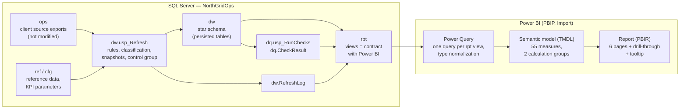

# Data Model and Refresh

> **SIMULATED SCENARIO.** NorthGrid Telecom and all its data are fictional.

## Architecture



## Layers

| Schema | Content | Who changes it |
|---|---|---|
| `ops` | Source exports as delivered by the client (simulated): customers, circuits, tickets, improvement actions | Source systems only. The BI layer never writes here |
| `ref`, `cfg` | Reference data and KPI parameters. One row added by CR-001 (`DPC`) | Client, through approved change requests |
| `dw` | Star schema rebuilt by `dw.usp_Refresh`, plus `dw.RefreshLog` | The processing job |
| `dq` | Data quality results and the review view of unmarked overlaps | `dq.usp_RunChecks` |
| `rpt` | One plain view per semantic model table, explicit columns | Developer; the contract read by Power BI |

## Tables

| Table (`dw`) | Model table | Grain | Rows (simulated data) | Keys |
|---|---|---|---|---|
| `DimDate` | Date | Day, 2024-01-01 to the last day in the data | 731 | `DateKey` (yyyymmdd); marked as date table on `Date` |
| `DimCircuit` | Circuit | Circuit, with customer and tier; inferred members for circuits missing from the inventory | 6,530 | `CircuitKey` |
| `DimPriority`, `DimRootCause`, `DimActionType`, `DimAgeBucket` | Priority, Root Cause, Action Type, Age Bucket | One row per code | 4 / 8 / 4 / 5 | Codes |
| `FactIncident` | Incident | Source ticket (all tickets, with `IncidentClass`) | 18,889 | `TicketId` |
| `FactBacklogDaily` | Backlog Snapshot | Open valid ticket × day | 27,083 | `SnapshotDateKey`, `TicketId` |
| `FactChronicDaily` | Chronic Snapshot | Chronic circuit × day | 36,170 | `SnapshotDateKey`, `CircuitKey` |
| `FactActionEffect` | Improvement Action | Improvement action | 558 | `ActionId` |
| `KpiParameter`, `dq.CheckResult`, `RefreshLog` | KPI Parameter, Data Quality Check, Processing Status | Disconnected support tables | 4 / 12 / per run | — |

Model-only tables: `_Measures` (measure home), `Trend Month` (disconnected month axis),
calculation groups `Time Comparison` and `Trend Window`.

## Relationships

All relationships are many-to-one, single direction (dimension filters fact). No bidirectional filters.

| From (many) | To (one) | Active |
|---|---|---|
| Incident[Opened Date Key] | Date[Date Key] | Yes |
| Incident[Restored Date Key] | Date[Date Key] | **No** — activated by restoration measures with `USERELATIONSHIP` |
| Incident[Circuit Key], [Priority Code], [Root Cause Code] | Circuit, Priority, Root Cause | Yes |
| Backlog Snapshot[Snapshot Date Key], [Circuit Key], [Priority Code], [Age Bucket Code] | Date, Circuit, Priority, Age Bucket | Yes |
| Chronic Snapshot[Snapshot Date Key], [Circuit Key] | Date, Circuit | Yes |
| Improvement Action[Completion Date Key] | Date | **No** — K9 uses fixed windows per action; the report month must not filter it |
| Improvement Action[Circuit Key], [Action Type Code] | Circuit, Action Type | Yes |

Filters that do not apply by design: Priority does not filter Chronic Snapshot (a circuit is chronic across
priorities) or Improvement Action. The report month does not filter Improvement Action.

## Refresh

### Sequence

```text
1. Source systems load ops            (outside this project)
2. dw.usp_Refresh                     rebuilds dw when the source changed
3. dq.usp_RunChecks                   data quality checks
4. Power BI semantic model refresh    only if 2 and 3 succeeded
```

Steps 2 and 3 run together with `database\refresh.ps1`, which exits with an error if the processing or any
check fails, so an orchestrator (SQL Server Agent, Windows Task Scheduler, Azure Data Factory, Power Automate)
can hold step 4. Orchestration itself is out of scope for this project.

### Suggested schedule

The requirement is a daily refresh after 06:00. Suggested: `refresh.ps1` at 05:30, Power BI refresh at 06:15.
Running `refresh.ps1` more often (for example every 2 hours) is safe: unchanged source data is skipped in
about 10 ms.

### Behaviour of `dw.usp_Refresh`

| Situation | Behaviour |
|---|---|
| Source, reference data and KPI parameters unchanged since the last successful run | Logged as `Skipped`; nothing is rebuilt. `@Force = 1` rebuilds anyway (needed after a change to the procedure itself) |
| A second run starts while one is running | Fails immediately (`sp_getapplock`, timeout 0) |
| Error during the rebuild | The transaction rolls back; `dw` keeps the previous complete result; the run is logged as `Failed` with the error line and message; the procedure re-throws so the caller fails |
| Readers during the rebuild | The rebuild is one transaction: readers wait or see the previous result, never a half-built star |
| Report | `rpt.vw_ProcessingStatus` feeds the header of every page with the data date and the time of the last successful run, and a warning when the latest run failed |

### Why a full rebuild instead of incremental processing

Every derived fact depends on time windows that reach back in history: a ticket restored today can turn a
ticket opened 29 days ago into a non-repeat, a late update changes chronic status for 60 days of snapshots,
and backlog snapshots change for every day a ticket stays open. Incremental logic would have to recompute
those windows anyway. With this volume the full rebuild takes about 4.7 seconds (measured on the development
laptop), so the change detection (skip when nothing changed) gives the benefit of incremental processing
without its risk. Incremental processing becomes worth it if the rebuild grows past the refresh window; the
natural step then is a rolling rebuild of the last N days (N = largest KPI window) with partition switching.

### Power BI

- Import mode; one Power Query per `rpt` view with an explicit `Table.TransformColumnTypes` step. All queries
  fold to a simple `SELECT`.
- Parameters `Server` (default `localhost`) and `Database` (`NorthGridOps`).
- Full model refresh: about 4.4 seconds; model cache about 1.6 MB (measured).
- Local SQL Server with a self-signed certificate: in Power BI Desktop, the data source `localhost;NorthGridOps`
  needs Windows credentials and **Encrypt connections** unchecked (File → Options and settings → Data source
  settings). This is a per-user setting and is not stored in the project.
