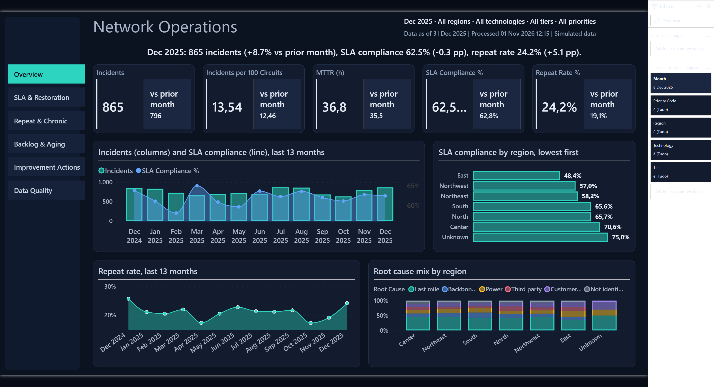
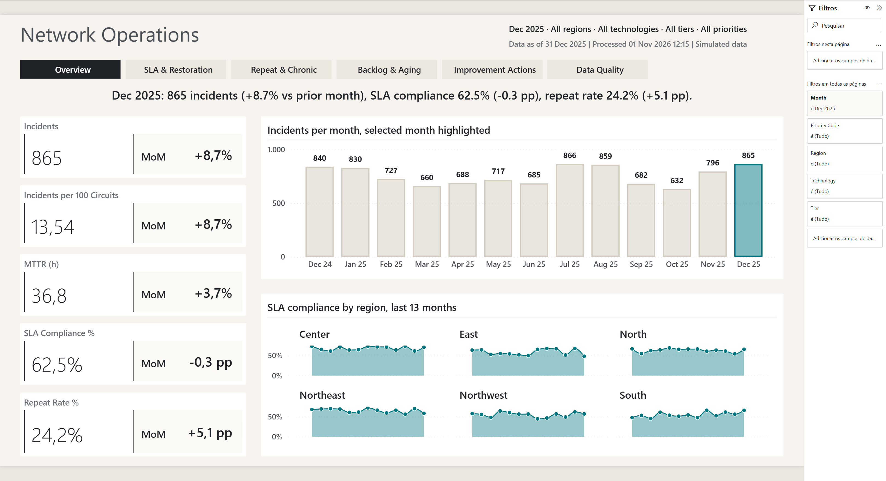
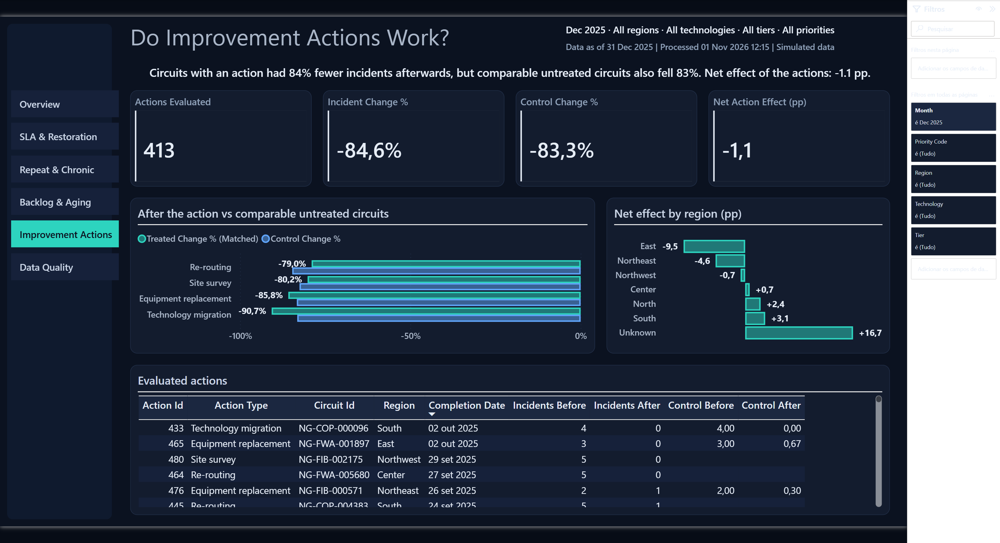
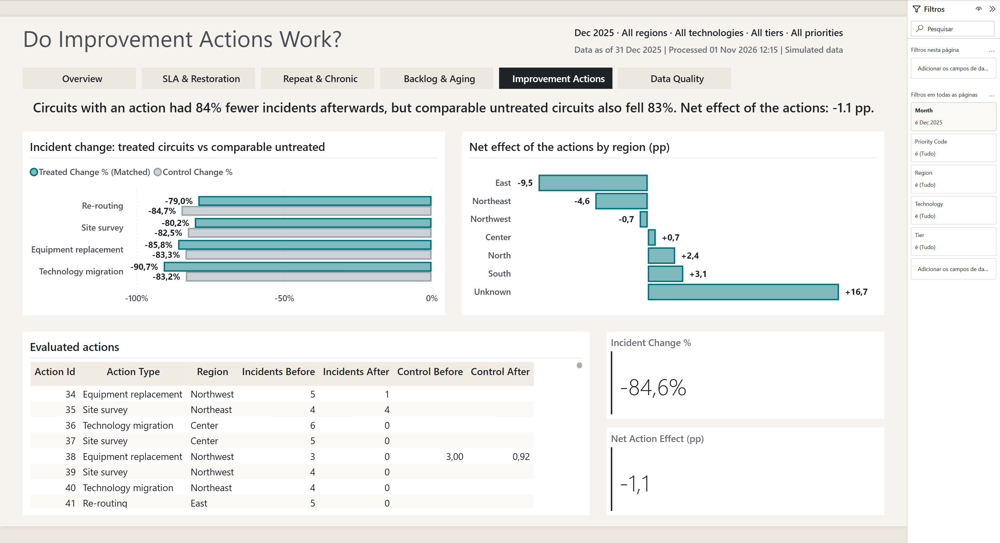

# Design Repertoire

> **SIMULATED SCENARIO.** NorthGrid Telecom and its data are fictional.

A working reference of layouts, colours and visual techniques for operations dashboards, collected for this
project and reused by its design variants. Principles are summarized in our own words; sources are listed at
the end.

## 1. What the research says

### Layout
- **Reading order.** Put the critical KPIs in the top band and read left to right, top to bottom (F-pattern):
  headline numbers first, comparisons and trends in the middle, detail and lists at the bottom.
- **Grid.** A 12-column grid with spacing in multiples of 8 px. Desktop pages split 3-3-3-3 (four equal
  blocks) or 4-8 (side column plus main area). Fixed 16:9 page (1280 × 720) instead of fit-to-window.
- **Density.** About 6–8 visuals per page and at most 3 slicers; one question per page.
- **KPI anatomy.** One primary number noticeably larger (about 40%) than the rest, with a variance against a
  reference (target or prior period) and some history (3–6 months or a sparkline).
- **Exception-based design for operations.** Highlight only what is off: conditional formatting on outliers,
  variance highlight, status colour used sparingly.

### Colour
- **One accent.** The brand or accent colour carries emphasis on 2–3 elements per page; everything else is
  neutral grey.
- **Small palette.** Up to about 6 categorical colours; sentiment colours (good/bad) keep one meaning everywhere.
- **Accessibility.** WCAG 2.1 AA contrast (4.5:1 for text). Never use colour as the only cue; avoid red/green
  pairs (colour vision deficiency).
- **Dark mode is its own system, not an inversion.** Palettes are designed for the surface they sit on; for dark
  backgrounds, raise lightness and saturation of the data colours, use an off-black page (around `#0B1220`–
  `#121212`) and lighter panels for depth. Light mode still reads better for dense tables, so a dark design
  keeps tables few and short.

### Typography
- One family (Segoe UI in Power BI), hierarchy by size and weight: titles 14–16 pt, labels 10–11 pt, KPI values
  much larger. Emphasis through weight or colour, never a second family.

### Chart vocabulary (FT Visual Vocabulary, mapped to built-in visuals)
| Relationship | Built-in Power BI visual |
|---|---|
| Change over time | Line, column (13-month window) |
| Ranking | Sorted bar (worst first when the job is to fix) |
| Deviation | Bar with positive/negative values (net effect) |
| Part-to-whole | 100% stacked column, stacked bar |
| Magnitude | Clustered bar/column |
| Correlation of volume and rate | Line and clustered column combo |
| Distribution across many groups | Small multiples (the *Rows* role of line charts) |

### Native-visual techniques seen in award-winning Power BI galleries
Bar charts with a target line, change arrows, dynamic highlighting of the selected item, Top N / Bottom N tables,
Pareto ranking, decomposition tree for root cause. All built-in, no custom visuals (the project's licensing
constraint).

### Palettes collected
| Source | Type | Colours |
|---|---|---|
| ColorBrewer RdYlBu (via a BIBB theme) | Diverging | `#D73027` `#F46D43` `#FDAE61` `#FEE090` `#E0F3F8` `#ABD9E9` `#74ADD1` `#4575B4` |
| ColorBrewer PiYG (via a BIBB theme) | Diverging | `#C51B7D` `#DE77AE` `#F1B6DA` `#FDE0EF` `#E6F5D0` `#B8E186` `#7FBC41` `#4D9221` |
| Economist-style bold | Editorial, one strong accent | `#E3120B` `#0098A6` `#FFD700` `#2C2C2C` `#8A8B8C` `#005F83` |
| Okabe-Ito (used by the original report) | Categorical, CVD-safe | `#0072B2` `#E69F00` `#56B4E9` `#009E73` `#CC79A7` `#D55E00` |

## 2. How the repertoire is applied

The project keeps the **original report unchanged** (git tag `v1.0-original`) and adds two design variants on the
**same semantic model and data**. All three answer the same questions with the same numbers; only layout,
colour and visual choices differ.

| | Original (`NorthGridOps.pbip`) | B — Midnight Ops (`NorthGridOps-Midnight.pbip`) | C — Editorial (`NorthGridOps-Editorial.pbip`) |
|---|---|---|---|
| Tone | Corporate | Technical / monitoring | Editorial / narrative |
| Background | Light grey, white panels | Navy `#0B1220`, panels `#131C2E` with thin borders | Warm paper `#F6F3EE`, white panels, no borders |
| Accent | Okabe-Ito blue/orange | Teal `#2DD4BF` (current, good), amber `#FBBF24` (attention), coral `#FB7185` (bad) | Deep teal `#00757F`, grey context `#9AA5AB`, orange `#C2410C` only for alerts |
| Signature | Header band with filter context | Fixed left navigation rail + KPI cards with "vs prior month" | Headline sentence on every page + the selected month highlighted in trends |
| Navigation | Page navigator (top) | Buttons in a left rail | Text tabs under the title |
| KPI cards | Classic card | New card with reference label (prior month, coloured change) | New card, minimal, stacked in a side column |
| Key visuals | Scorecard matrix, trends, 100% bars | Volume + SLA combo, SLA heatmap tier × priority, small multiples by technology | Highlighted month columns, small multiples of SLA by region, ranked bars |
| Best for | Monthly review, Excel export | Operations room, daily monitoring on a large screen | Leadership meetings, sending a report with the story written |

### Rules both variants follow
- Same report-level filters (month, region, technology, tier, priority) and the same KPI definitions.
- Every chart shows all its categories without scrolling (the original's region chart hides one region below its
  scroll bar; the variants fix that with taller charts).
- Change colours: teal = improved, orange = worsened, grey = no change, with polarity per KPI (lower is better
  for incidents, MTTR and repeat rate; higher is better for SLA). Colour is never the only cue: the change is
  also written as a signed number.
- Backlog aging uses a sequential scale with the alert colour only for more than 30 days.

### Model support added for the variants
New measures in the display folder *8. Design Support* (the original report does not use them):
explicit prior-month values, month-over-month changes and change colours for the five headline KPIs (new card
reference labels cannot use a calculation group), and one headline sentence per page. The *Trend Window*
calculation group leaves colour measures untouched, so a report can highlight the selected month on a
13-month axis. Variant colours for that highlight live in each report as report-level measures, not in the model.

### Screenshots
Taken from each report open in Power BI Desktop after its data was refreshed:
`docs/screenshots/variants/midnight/` and `docs/screenshots/variants/editorial/` (pages 01–06).

| Midnight Ops | Editorial |
|---|---|
|  |  |
|  |  |

### What the build taught (worth reusing)
- **Start from a clean base or override the base theme explicitly.** The `sqlbi` base theme sets white visual
  backgrounds, a page background image, an empty title area and 10 px padding on every visual. A dark design
  has to override each of them in the theme; otherwise panels stay white and cards and buttons lose height.
- **Theme changes need the report to be reopened** in Power BI Desktop; a canvas reload does not apply them.
- **New card with a reference label:** put the reference to the right of the value when the card is short;
  below the value it crops the number.
- **Buttons as navigation** are fully formattable through `pbir`; the page navigator visual is not.
- **Categorical bar charts scroll silently** when the category count exceeds the height: check every chart
  shows all categories (the original's region chart hides one region this way).

### Known limitations of the variants
- **Change colour on new cards.** Midnight cards show the month-over-month change (`+8.7%`, `-0.3 pp`) as
  their reference label, but not coloured: `pbir` writes conditional formatting on new cards with a generic
  selector that Power BI ignores (tested on the reference value, the detail line and the accent bar), and the
  project rules forbid editing the JSON by hand. The sign carries the direction; the colour measures
  (`<KPI> MoM Color`) are ready. The same applies to Editorial.

### Editorial refinement (second round)
KPI cards with the month-over-month change in a tabular reference label (`MoM −0,3 pp`), short month labels on
the 13-month columns, small multiples on a continuous month axis (no scroll bars) without the Unknown member,
headlines that fit, data quality table without horizontal scroll.

### Midnight refinement (second round)
Month-over-month change on the KPI cards, short month labels (`Dec 24`) on every 13-month axis, brand block on
the navigation rail, shorter Repeat title, full headlines, small multiples without scroll bars and without the
"Unknown" technology, data quality table without horizontal scroll, all regions visible in the aging chart.

## Sources

- SR Analytics, "Power BI dashboard examples and design" — https://sranalytics.io/blog/power-bi-dashboard-examples-design/
- AlphaBOLD, "Top Power BI dashboard design tips" — https://www.alphabold.com/top-power-bi-dashboard-design-tips-for-clear-and-impactful-visuals/
- Dashboard-Design, "Power BI Design Files" (gallery and theme files) — https://github.com/Dashboard-Design/Power-BI-Design-Files
- Financial Times, "Visual Vocabulary" — https://github.com/Financial-Times/chart-doctor/tree/main/visual-vocabulary
- IBCS standards overview — https://www.ibcs.com/standards/
- Dark-mode guidance: American Express design system (data visualization colour), Mode (brand palettes for dark
  backgrounds), Eleken (dark mode UI), InterWorks (light vs dark mode readability), found via web search
- data-goblin, power-bi-agentic-development: `pbi-report-design` skill (design identity, page shapes)
