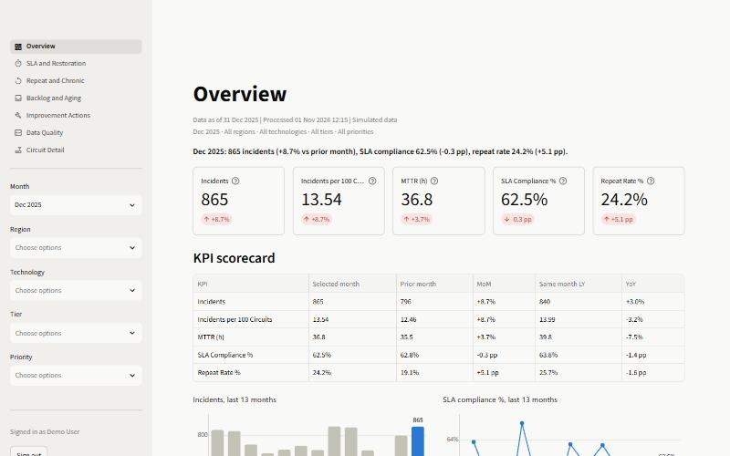
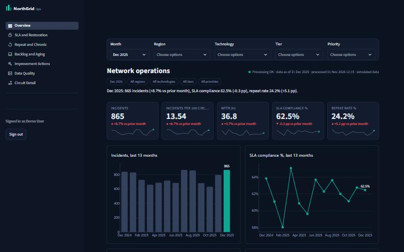
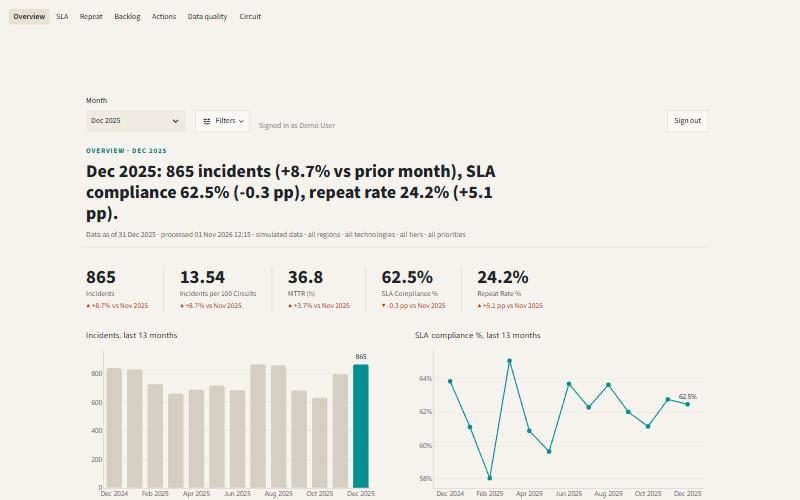

# Streamlit Design Repertoire

> **SIMULATED SCENARIO.** NorthGrid Telecom and its data are fictional.

The Streamlit counterpart of `DESIGN_REPERTOIRE.md`: the techniques available in Streamlit 1.66 for making a
data app look designed rather than default, and how the three designs of the Streamlit version use them.
The layout and colour principles in `DESIGN_REPERTOIRE.md` (reading order, one accent, small palette,
accessible contrast, dark mode as its own system) still apply and are not repeated here.

## 1. What Streamlit offers, in the order to reach for it

### Native theme (`.streamlit/config.toml`)
Streamlit's own guidance is to use native theming first and custom CSS last. Its CSS class names are not a
public API and change between releases. Version 1.66 covers more than colours. The keys below were
checked against the installed version:

| Need | Keys |
|---|---|
| Light or dark base and the main colours | `base`, `primaryColor`, `backgroundColor`, `secondaryBackgroundColor`, `textColor`, `borderColor` |
| Shape | `baseRadius`, `buttonRadius`, `showWidgetBorder` |
| Typography | `font`, `headingFont`, `headingFontWeights`, `headingFontSizes`, `codeFont`, `baseFontSize`, `metricValueFontSize` |
| Tables | `dataframeHeaderBackgroundColor`, `dataframeHeaderTextColor`, `dataframeBorderColor` |
| Chart defaults | `chartCategoricalColors`, `chartSequentialColors`, `chartDivergingColors` |
| Sidebar with its own colours | `[theme.sidebar]` |
| Light and dark variants the viewer can switch | `[theme.light]`, `[theme.dark]` (and their `.sidebar` tables) |

The theme reaches places CSS cannot reliably reach, such as the canvas-drawn `st.dataframe`. That is why
the dark design sets its table header and border colours here.

### Layout primitives
- `st.navigation(position="sidebar" | "top" | "hidden")`: a navigation rail or tabs across the top.
- `st.container(border=True)` for card panels. `st.container(horizontal=True, ...)` for toolbars.
  `st.columns` with weights for grids.
- `st.popover` to park secondary controls. `st.logo` for a brand mark at the top of the sidebar.
- `st.metric(..., border=True)` for native KPI cards, with an arrow and a coloured change.
- `st.column_config` for table columns: progress bars, dates, check boxes.

### Scoped CSS through container keys
A container created with `key="filterbar"` gets the class `st-key-filterbar`. CSS that targets only these
classes survives Streamlit upgrades, unlike CSS that targets Streamlit's own classes. The two variant
stylesheets follow that rule: they style their own HTML components and keyed containers, nothing else.

### HTML injection (`st.html`)
For components Streamlit does not have, such as KPI tiles with a sparkline, a kicker and headline, or a
sentence-style stat line:
- `st.html` sanitizes the markup with DOMPurify, ignores JavaScript by default, and is not iframed, so the
  page's CSS applies to it. `st.html(Path("style.css"))` injects a stylesheet.
- **Inline SVG is removed by the sanitizer.** Sparklines are passed as ``
  instead. This was found during the build: the first version rendered empty tiles.
- **Every value from the database is escaped** with `html.escape` before it goes into markup (customer names,
  regions, circuit ids). The markup itself is written in the code, never built from user input.
- JavaScript stays off (`unsafe_allow_javascript` is not used).

### Charts
Plotly with `theme=None` and one `ui.style()` function per app, so every chart follows the design's theme object
(`ui.Theme`): the measure in focus, context grey, ink, grid, alert, categorical, ordinal and heatmap colours.
The palettes were checked with the dataviz skill's validator (`validate_palette.js`): lightness band, chroma
floor, colour-vision-deficiency separation and contrast against the surface the charts sit on.

### Sources
- Streamlit docs, "Theming overview" and "Customize fonts":
  https://docs.streamlit.io/develop/concepts/configuration/theming,
  https://docs.streamlit.io/develop/concepts/configuration/theming-customize-fonts
- Streamlit forum FAQ on custom styling (CSS is possible but not endorsed; class names change):
  https://discuss.streamlit.io/t/faq-how-to-customize-the-style-or-appearance-of-your-streamlit-app/63878
- Streamlit agent skill "building-streamlit-dashboards" (bordered cards and metrics):
  https://skills.sh/streamlit/agent-skills/building-streamlit-dashboards
- Examples of styled apps and packages reviewed for ideas, not copied: st-styled (https://github.com/EvobyteDigitalBiology/st-styled/),
  streamlit-kpi-card (https://pypi.org/project/streamlit-kpi-card/), a centralized-stylesheet example on Hugging Face
  (https://huggingface.co/nsrek/ECGLight/blob/main/utils/css.py)
- Streamlit 1.66 source as installed (`streamlit/config.py` for theme keys, `streamlit/elements/html.py` for
  the sanitizer and JavaScript rules)

## 2. The three designs

All three read the same views, use the same KPI functions (`kpis.py`), headline sentences (`narrative.py`) and
login (`auth.py`), and show the same numbers. Each runs as its own Streamlit server, because the native theme
is per server.

| | Classic (`app/`) | Midnight Ops (`app/variants/midnight/`) | Editorial (`app/variants/editorial/`) |
|---|---|---|---|
| Tone | Neutral, close to Streamlit's default | Technical, operations room | Narrative, leadership report |
| Base | Light | Dark: page `#0B1220`, panels `#131C2E` | Warm paper `#F6F3EE`, no panels |
| Accent | Blue `#2a78d6` | Teal `#12A594`, coral `#E5484D` for alerts | Teal `#009191`, orange `#C2410C` for alerts |
| Navigation | Sidebar | Sidebar as a navigation rail with a logo | Tabs across the top (`position="top"`) |
| Filters | Sidebar | One filter bar above every page (keyed container) | The month up front, the rest in a popover |
| KPIs | `st.metric` cards | HTML tiles: value, change with arrow and sign, 13-month sparkline | A line of large numbers with the change written out ("▲ +8.7% vs Nov 2025"), no boxes |
| Page header | Title, status caption | Title, status dot (green, or red when the last run failed), filter chips | Kicker, the headline sentence as the title, standfirst |
| Signature visuals | Scorecard table, stacked root causes | SLA heatmap on the overview, progress bars on the worst breaches | Small multiples of SLA by region, dumbbell of treated vs control, root-cause share with one accent |
| Best for | Daily use, exporting tables | A wall screen in the operations room | A monthly read or a meeting |
| Port in `.claude/launch.json` | 8510 | 8511 | 8512 |

| Classic | Midnight Ops | Editorial |
|---|---|---|
|  |  |  |

### Rules all three follow
- Colour follows the entity: root causes and age buckets keep their colour when filters change.
- A change is never shown by colour alone: it always has a sign, and an arrow on cards, tiles and stats.
- Polarity per KPI: lower is better for incidents, MTTR, repeat rate and backlog; higher is better for SLA.
- The alert colour is used for one thing only: backlog older than 30 days and actions that increased incidents.
- Text that carries meaning clears WCAG AA (4.5:1). The coral used for text in Midnight is a lighter step,
  `#F06A6E` at 5.7:1, than the coral used for marks, `#E5484D` at 4.35:1 on the panel.

### What the build taught
- Run the palette validator early. Four first picks failed:
  - the Editorial teal read as grey (chroma below the floor);
  - the Midnight accents were outside the dark-mode lightness band;
  - the Midnight age ramp had two steps too close together;
  - the lightest Editorial age step was too pale against white.
- In a dark design, the oldest bucket of a sequential scale should be the brightest, because brightness
  draws the eye on a dark surface.
- Small-multiple labels go to the right of the last point. Above it, the label hid the last segment of the line.
- A module-level theme set once at start-up is enough. Each design is its own server process, so nothing is
  shared between designs at run time.

### Known limitations
- Midnight drops the evaluated-actions list and the handling column of the data quality checks to stay dense.
  Classic and Editorial keep them.
- The Editorial width limit and the variant components rely on CSS scoped to keyed containers and to the
  variants' own HTML. If a future Streamlit release changes how keys map to classes, the layout falls back to
  full width and default styling. The data is not affected.
- Screenshots are 800 × 500 captures of a 1440 × 900 viewport from the in-app browser.
